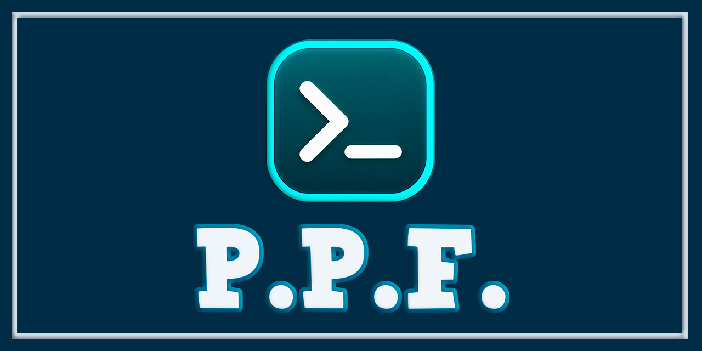

# Pablitus Prompt Framework (PPF)

Pablitus Prompt Framework (PPF) es un framework modular para construir prompts de **PowerShell 7+** con una arquitectura clara, rápida y personalizable.

Separa la recolección de datos, la construcción del contexto, el middleware, los segmentos, la resolución de temas y el renderizado en capas independientes. Esto permite cambiar el aspecto del prompt sin reescribir la lógica que obtiene la información del sistema.

PPF funciona de forma local, no depende de servicios externos para renderizar el prompt y está diseñado para Windows, Linux y macOS.

---


---



---

## Características principales

- Arquitectura modular con responsabilidades separadas.
- **13 proveedores** integrados para contexto, entorno y estado del sistema.
- **14 segmentos** visuales reutilizables.
- **8 renderers** de salida: Plain, Minimal, JSON, ANSI, PowerLine, Markdown, HTML y Rich.
- **14 temas** integrados: Default, Nord, Dracula, Catppuccin, Kali, Pablitus, Pablitus Dark, Pablitus Light, Pablitus Neon, Pablitus Matrix, Pablitus Ocean, Pablitus Sunset, Pablitus Forest y Pablitus Cyberpunk.
- Bloques PowerLine truecolor para Dracula, Nord, Catppuccin y Kali.
- Segmento de hora con icono de reloj de Nerd Font (`U+F017`).
- Importación de temas personalizados sin modificar el repositorio.
- Bootstrap rápido que compila las fuentes modulares en una sola carga.
- Omisión opcional de proveedores cuyos segmentos están ocultos por el tema.
- Caché en memoria y en disco.
- Importación, exportación y recarga en caliente de configuración.
- Sistema de eventos para `BeforeRender`, `AfterRender`, `ThemeChanged`, `ConfigurationChanged` y `ModuleLoaded`.
- Sampler de CPU respaldado por runspaces.
- Watcher de repositorios Git.
- Diagnóstico de salud, benchmarks y telemetría de rendimiento.
- Funcionamiento local, sin telemetría remota ni dependencia de APIs externas.
- Compatibilidad con Windows, Linux y macOS.
- Suite de pruebas con Pester y análisis estático con PSScriptAnalyzer.

---

## Componentes

PPF combina proveedores, segmentos, renderers y temas. Cada capa puede utilizarse de forma independiente o extenderse con la API pública.

### Proveedores

Los proveedores recopilan información del sistema, del entorno de PowerShell o del directorio actual y la depositan en el `PromptContext`.

| Proveedor | Información |
| --- | --- |
| `Session` | Usuario, host, sistema operativo, shell y estado de elevación. |
| `WSL` | Detección de WSL y nombre de la distribución. |
| `Path` | Directorio actual, ruta abreviada y ruta relativa al home. |
| `Project` | Tipo de proyecto detectado: Node, Python, .NET, etc. |
| `Git` | Rama, commit, estado limpio/sucio, archivos sin seguimiento y ahead/behind. |
| `Docker` | Estado del daemon y cantidad de contenedores activos. |
| `Python` | Versión de Python y entorno virtual activo. |
| `Node` | Versión de Node.js y contexto del proyecto. |
| `DotNet` | Versión de .NET y archivos de proyecto. |
| `Kubernetes` | Contexto, namespace y estado de conexión. |
| `Battery` | Porcentaje de batería y estado de carga. |
| `CPU` | Porcentaje de uso de CPU. |
| `Memory` | Memoria total, disponible y porcentaje de uso. |

### Segmentos

Los segmentos construyen los bloques visibles del prompt a partir del contexto.

- `Session`
- `Project`
- `Path`
- `Git`
- `Python`
- `Node`
- `Docker`
- `WSL`
- `Battery`
- `CPU`
- `Memory`
- `Kubernetes`
- `DotNet`
- `Time`

Cada tema puede ocultar, mostrar o reconfigurar cualquier segmento sin modificar el código del proveedor.

### Renderers

| Renderer | Salida |
| --- | --- |
| `Plain` | Texto plano sin códigos ANSI. |
| `Minimal` | Prompt corto con el directorio esencial. |
| `JSON` | Contexto y segmentos en JSON válido. |
| `ANSI` | Colores ANSI de 16 colores. |
| `PowerLine` | Bloques truecolor con separadores y diamantes. |
| `Markdown` | Texto con formato Markdown. |
| `HTML` | Segmentos envueltos en HTML con estilos. |
| `Rich` | Diseño de terminal con símbolos y estilos enriquecidos. |

El renderer `PowerLine` requiere una **Nerd Font** instalada y seleccionada en la terminal.

### Temas

| Tema | Estilo | Paleta principal | Mejor caso de uso |
| --- | --- | --- | --- |
| `Default` | Base ANSI clásica | Cyan, Blue, Green, Yellow, Magenta, Red | Prompts sencillos y compatibles con cualquier terminal sin Nerd Font. |
| `Nord` | Polar Night, Frost y Aurora | `#5e81ac`, `#434c5e`, `#a3be8c`, `#ebcb8b` | Escritorios oscuros con buena legibilidad y bloques PowerLine. |
| `Dracula` | Paleta oficial Dracula | `#44475a`, `#6272a4`, `#ffb86c`, `#8be9fd`, `#ff79c6` | Estilo oscuro clásico con alto contraste y silueta de Oh My Posh. |
| `Catppuccin` | Catppuccin Mocha | `#cba6f7`, `#585b70`, `#fab387`, `#a6e3a1`, `#89b4fa` | Paleta pastel suave sobre fondo oscuro para sesiones largas. |
| `Kali` | Verde, cian y ámbar | `#00a86b`, `#00838f`, `#ffc107`, `#ff9800`, `#9c27b0` | Entornos de seguridad y auditoría con `user@host` visible. |
| `Pablitus` | PowerLine truecolor oscuro | `#1e1e2e`, `#89b4fa`, `#a6e3a1`, `#f38ba8` | Tema oficial de PPF: Session, Path, Git y Time con diamantes. |
| `Pablitus Dark` | PowerLine truecolor muy oscuro | `#0a0a0a`, `#bb86fc`, `#03dac6`, `#ff5252` | Fondos negros; transient prompt con `right_template` y `filler`. |
| `Pablitus Light` | PowerLine truecolor claro/neón | `#fafafa`, `#ff00ff`, `#00e5ff`, `#00ff9f` | Terminales con tema claro; diamantes magenta, cian y naranja. |
| `Pablitus Neon` | PowerLine truecolor neón oscuro | `#0a0a0a`, `#ff00ff`, `#00e5ff`, `#00ff9f` | Estilo neón vibrante sobre fondo oscuro; diamantes magenta, cian y verde. |
| `Pablitus Matrix` | PowerLine truecolor verde matriz | `#000000`, `#00ff00`, `#33ff33` | Estilo monocromo verde matriz; sesiones de hacking y terminales oscuros. |
| `Pablitus Ocean` | PowerLine truecolor azul océano | `#0a192f`, `#64ffda`, `#1d3557`, `#233554` | Desarrollo con rutas, Git y Docker; transient prompt y tooltips. |
| `Pablitus Sunset` | PowerLine truecolor atardecer | `#2d1b19`, `#ef476f`, `#118ab2`, `#06d6a0` | Sesiones nocturnas con tonos cálidos; right prompt con `overflow: break`. |
| `Pablitus Forest` | PowerLine truecolor verde bosque | `#2e8b57`, `#98fb98`, `#8b4513` | Ideal para entornos naturales y desarrollo outdoors; paleta verde bosque con estilo powerline. |
| `Pablitus Cyberpunk` | PowerLine truecolor neón | `#0a0a0f`, `#ff00ff`, `#00ffff`, `#ffff00` | Ideal para ciberseguridad y desarrollo nocturno; paleta neón magenta, cian y amarilla sobre fondo oscuro. |

Los temas PowerLine comparten la misma gramática visual de bloques, diamantes y glifos de Nerd Font, pero cada uno define su propia paleta, contraste y acentos. El segmento `Time` usa el icono de reloj de Nerd Font (`U+F017`).

---

## Diagnóstico y observabilidad

PPF incluye herramientas para inspeccionar el estado del framework y medir su rendimiento.

```powershell
Get-PromptHealth
Test-PromptFramework
Measure-Prompt
Measure-PromptDetailed
Measure-PromptCacheComparison
```

También se puede ajustar el nivel de logging:

```powershell
Set-PPFLogLevel -Level "DEBUG"
Set-PPFLogLevel -Level "INFO"
```

Niveles disponibles: `TRACE`, `DEBUG`, `INFO`, `WARN` y `ERROR`.

La telemetría local registra tiempos de providers, segmentos y renderers, además de estadísticas de caché. No se envía información a servicios externos.

---

## Arquitectura

PPF está organizado en capas con dependencias explícitas:

- `Core`: ciclo de vida del prompt, registro, caché, eventos, telemetría y renderizado.
- `Configuration`: configuración, valores por defecto, importación/exportación y hot reload.
- `Utils`: utilidades para ejecución segura de comandos externos.
- `Modules`: providers, services y segments de cada capacidad.
- `Themes`: paletas, iconos y valores por defecto de los segmentos.
- `Renderers`: formatos de salida.
- `Profile` y `examples`: integración opcional con perfiles y temas de ejemplo.
- `tests`: pruebas de regresión, integración y cobertura.

### Bootstrap rápido

`PablitusPrompt.psm1` lee las fuentes modulares en orden de dependencia, las concatena y las ejecuta una sola vez. Esto evita el coste de importar decenas de archivos pequeños sin perder la organización del código.

El modo activo se expone en:

```powershell
$global:PPF_BootstrapMode
```

Valores posibles: `Fast` o `Modular`.

Para forzar el cargador modular, por ejemplo durante cobertura con Pester:

```powershell
$env:PPF_USE_MODULAR_LOADER = "1"
Import-Module .\src\PablitusPrompt.psd1 -Force
```

### Omisión de proveedores ocultos

Por defecto todos los proveedores se ejecutan. Si el tema activo oculta segmentos, se puede evitar su coste con:

```powershell
$global:PPF_SkipHiddenProviders = $true
```

Los proveedores visibles conservan las dependencias que necesitan. Por ejemplo, el segmento Python puede seguir usando información del proveedor Project.

---

## Estructura del proyecto

```text
PablitusPrompt/
├── src/
│   ├── PablitusPrompt.psd1
│   ├── PablitusPrompt.psm1
│   ├── Bootstrap.ps1
│   ├── Core/
│   ├── Configuration/
│   ├── Utils/
│   ├── Modules/
│   ├── Themes/
│   ├── Renderers/
│   └── Profile/
├── docs/
├── examples/
├── tests/
├── benchmarks/
├── build/
├── images/
├── CHANGELOG.md
├── RELEASE_DESCRIPTION.md
└── README.md
```

### `src/Core/`

Contiene el ciclo de vida del prompt, el contexto, el registro de componentes, la caché, los eventos, la telemetría y el motor de renderizado.

### `src/Configuration/`

Contiene la configuración del prompt, los valores por defecto, la importación/exportación y la recarga en caliente.

### `src/Modules/`

Contiene los providers, services y segments organizados por capacidad. Cada módulo puede crecer sin afectar a los demás.

### `src/Themes/`

Contiene los temas integrados. Cualquier archivo `*.Theme.ps1` en esta carpeta se carga automáticamente.

### `src/Renderers/`

Contiene los renderers de salida. Cada renderer transforma el contexto y los segmentos en un formato específico.

### `examples/`

Contiene ejemplos listos para usar, incluido un tema personalizado:

```text
examples/Themes/Sunset.Theme.ps1
```

### `tests/`

Contiene la suite de Pester, pruebas de regresión, pruebas de resiliencia y scripts de soak/stress.

### `benchmarks/`

Contiene reportes y artefactos generados por las herramientas de medición.

---

## Flujo de procesamiento

La carga del módulo sigue este orden:

```text
Import-Module
    │
    ▼
PablitusPrompt.psd1
    │
    ▼
PablitusPrompt.psm1
    │
    ├── Core
    ├── Configuration
    ├── Utils
    ├── Modules
    ├── Themes
    └── Renderers
    │
    ▼
Public API
```

La generación del prompt sigue este flujo:

```text
Invoke-Prompt
    │
    ▼
New-PromptContext
    │
    ▼
Providers
    │
    ▼
Pipeline
    │
    ▼
Segments
    │
    ▼
Get-PromptString
    │
    ▼
Renderer
```

Esta separación permite cambiar la presentación sin alterar la recolección de datos y ampliar los proveedores sin reconstruir el sistema completo.

---

## Renderizado y salida

El renderer se selecciona al generar el prompt:

```powershell
$context = Invoke-Prompt
Get-PromptString -Context $context -Renderer "PowerLine"
```

También se puede usar el renderer configurado por defecto:

```powershell
Get-PromptString
```

Para guardar o integrar el prompt en otros flujos:

```powershell
Get-PromptString -Renderer "JSON" | ConvertFrom-Json
Get-PromptString -Renderer "HTML" | Set-Content .\prompt.html -Encoding utf8
```

### PowerLine

El renderer `PowerLine` genera bloques con fondo truecolor, separadores triangulares y diamantes de apertura/cierre. Está pensado para terminales modernas con soporte de color de 24 bits y Nerd Font.

Si la terminal no soporta truecolor, se puede usar `ANSI` o `Plain`.

---

## About

| Campo | Valor |
| --- | --- |
| Nombre | Pablitus Prompt Framework (PPF) |
| Descripción | Framework modular para prompts de PowerShell 7+. |
| Versión | `1.5.0` |
| Plataforma | Windows, Linux y macOS. |
| Tecnología | PowerShell 7+, .NET, ANSI/TrueColor y Nerd Font. |
| Modo de operación | Local, sin telemetría remota. |
| Autor | Walter Pablo Téllez Ayala. |
| Ubicación | Bolivia. |
| Año | 2026. |

PPF está pensado para quienes quieren un prompt propio, comprensible y extensible, sin depender de un servicio externo ni de una configuración opaca.

---

## Codificación y compatibilidad internacional

El proyecto está diseñado para trabajar con contenido **UTF-8**.

Los temas PowerLine utilizan glifos de Nerd Font y secuencias ANSI truecolor. Para una representación correcta se recomienda:

- Una terminal con soporte de color de 24 bits.
- Una Nerd Font instalada y configurada.
- `$PSStyle.OutputRendering = "Ansi"` cuando se inspeccionan salidas con color en PowerShell.

Los nombres de usuario, hosts, rutas y ramas Git conservan los caracteres proporcionados por el sistema. Si el entorno utiliza otra codificación, algunos glifos pueden mostrarse como signos de interrogación o cuadros.

---

## Compatibilidad

### PowerShell

Compatible con:

```text
PowerShell 7.0 o superior
```

El proyecto se desarrolla y valida con PowerShell 7.6.7.

### Multi-shell

PPF es un módulo de PowerShell, pero incluye scripts de inicialización en
`src/ShellInit/` que permiten usarlo desde otros shells (bash, zsh, fish, cmd)
invocando a `pwsh` para obtener el prompt:

| Archivo | Shell | Uso |
|---------|-------|-----|
| `ppf.bash` | bash | `source /ruta/a/ppf.bash` en `~/.bashrc` |
| `ppf.zsh` | zsh | `source /ruta/a/ppf.zsh` en `~/.zshrc` |
| `ppf.fish` | fish | `source /ruta/a/ppf.fish` en `~/.config/fish/config.fish` |
| `ppf.cmd` | cmd | Llamar desde un macro o AutoRun |

Estos scripts inician `pwsh` para renderizar el prompt de PPF y lo inyectan como
`PS1`/`PROMPT` del shell anfitrión. Nota: iniciar `pwsh` en cada prompt añade
un coste de arranque; para uso diario se recomienda usar PPF directamente desde
PowerShell 7+.

### Sistema operativo

- Windows
- Linux
- macOS

### Terminales recomendadas

- Windows Terminal
- WezTerm
- Alacritty
- Kitty
- iTerm2
- Terminales compatibles con ANSI truecolor y Nerd Font

### Dependencias opcionales

Los proveedores de Git, Node, Python, Docker y Kubernetes detectan sus herramientas localmente. Si una herramienta no está instalada, el segmento correspondiente se omite o se degrada sin romper el prompt.

---

## Funcionamiento local

PPF está diseñado para funcionar de forma local.

El renderizado del prompt no requiere:

- APIs externas.
- Servidores remotos.
- Servicios web.
- Conexión a Internet.
- Envío de telemetría a terceros.

La información se obtiene del sistema local, del entorno de PowerShell y de las herramientas instaladas. La caché y los logs se guardan en las rutas locales del usuario.

---

## Instalación

### Desde PowerShell Gallery (recomendado)

PPF se distribuye como módulo de PowerShell en PowerShell Gallery:

```powershell
Install-Module -Name PablitusPrompt -Scope CurrentUser
Import-Module PablitusPrompt -Force
```

Actualizar a una versión más reciente:

```powershell
Update-Module -Name PablitusPrompt
```

### Desde el repositorio (fuente)

Clona el repositorio o descarga una copia:

```powershell
git clone https://github.com/Pablitus666/PablitusPrompt.git
```

Importa el manifiesto del módulo:

```powershell
Import-Module .\src\PablitusPrompt.psd1 -Force
```

También se puede usar el bootstrap:

```powershell
. .\src\Bootstrap.ps1
```

### Verificar la instalación

```powershell
Get-PromptHealth
Get-PromptThemes
Get-PromptProviders
Get-PromptRenderers
```

---

## Configuración del prompt

Agrega un bloque como este a tu `$PROFILE` y ajusta la ruta del repositorio:

```powershell
$PPF = "D:\PablitusPrompt\src"

if (Test-Path (Join-Path $PPF "Bootstrap.ps1")) {
    try {
        . (Join-Path $PPF "Bootstrap.ps1")

        Set-PromptTheme -Name "Dracula"
        $global:PPF_SkipHiddenProviders = $true

        function global:prompt {
            try {
                $context = Invoke-Prompt
                Get-PromptString -Context $context -Renderer "PowerLine"
            }
            catch {
                "PS $($executionContext.SessionState.Path.CurrentLocation)$('>' * ($nestedPromptLevel + 1)) "
            }
        }
    }
    catch {
        Write-Warning "[PPF] No se pudo cargar el prompt: $_"
    }
}
```

El `try/catch` garantiza que un fallo de un proveedor, segmento o renderer no deje la consola sin prompt.

Para volver al prompt anterior, elimina la función `prompt` del perfil o comenta el bloque.

---

## Ejemplo de ejecución

```powershell
Import-Module .\src\PablitusPrompt.psd1 -Force

Set-PromptTheme -Name "Nord"

$context = Invoke-Prompt
Get-PromptString -Context $context -Renderer "PowerLine"
```

Ejemplo de prompt PowerLine:

```text
  Pablo   PablitusPrompt   main   13:53 
```

La salida exacta depende del tema, del directorio actual, de las herramientas instaladas y de los segmentos visibles.

---

## Fase 3C: Prompt transitorio, tooltips y right prompt

Desde la versión 1.5.0, PPF incluye soporte para tres funcionalidades avanzadas de la línea de comandos inspiradas en Oh My Posh:

- **Right prompt**: un bloque alineado a la derecha del prompt principal.
- **Prompt transitorio**: un prompt simplificado que se muestra tras aceptar un comando, liberando espacio en pantalla.
- **Tooltips**: segmentos right-aligned que aparecen al escribir palabras clave (por ejemplo, `git`, `docker`).

### Requisito: núcleo .NET

Estas funciones se renderizan con el núcleo .NET de PPF y requieren el modo opt-in:

```powershell
$env:PPF_USE_DOTNET_CORE = "1"
Import-Module PablitusPrompt -Force
```

El ancho de terminal, la línea de comandos y la columna del cursor se pasan desde el llamador (CLI o adaptador de PowerShell); el núcleo .NET no consulta la consola, por lo que el resultado es determinista y testeable. Si el núcleo no está disponible, PPF hace fallback al motor de PowerShell.

### Right prompt

Se configura con un bloque `type: "rprompt"` (o `alignment: "right"`) en un tema declarativo JSON:

```json
{
  "name": "MiTema",
  "renderer": "powerline",
  "blocks": [
    {
      "type": "prompt",
      "alignment": "left",
      "segments": [
        { "type": "session", "template": "{{ .UserName }}@{{ .HostName }}", "style": "plain" },
        { "type": "path", "template": "{{ .Path.Display }}", "style": "plain" }
      ]
    },
    {
      "type": "rprompt",
      "alignment": "right",
      "filler": "·",
      "overflow": "hide",
      "segments": [
        { "type": "text", "template": "{{ .Path.Folder }}", "style": "plain" }
      ]
    }
  ]
}
```

Cuando se conoce el ancho de terminal, el núcleo combina ambos bloques con el `filler` repetido o un movimiento absoluto de cursor:

```powershell
Get-PromptString -TerminalWidth 80
```

`overflow: hide` oculta el right prompt si desborda el ancho disponible; `overflow: break` lo lleva a una nueva línea.

### Prompt transitorio

Un prompt simplificado que se muestra tras aceptar un comando:

```powershell
Get-PromptString -Transient -TerminalWidth 80
```

Soporta `template`, `right_template`, `filler`, `newline`, `foreground` y `background`. Devuelve `$null` si el tema activo no define un `transientPrompt`.

### Tooltips

Segmentos right-aligned que se muestran al escribir palabras clave específicas (`tips`). Útil para mostrar información contextual mientras escribes comandos como `git` o `docker`:

```powershell
Get-PromptTooltip -Command "git" -TerminalWidth 80 -Column 5
```

Devuelve el texto del tooltip alineado a la derecha, o `$null` si no hay coincidencia con ninguna palabra clave configurada.

#### `tooltips_action`: replace / extend / prepend

Controla cómo se combina el tooltip con el right prompt actual:

| Valor | Comportamiento | Predeterminado |
| --- | --- | --- |
| `replace` | Reemplaza el right prompt actual por el tooltip. | Sí |
| `extend` | Añade el tooltip al final del right prompt. | No |
| `prepend` | Antepone el tooltip al inicio del right prompt. | No |

Se configura en el tema con `tooltipsAction`:

```json
{
  "tooltips": [
    {
      "tips": ["git"],
      "type": "text",
      "template": "rama: {{ .Git.Branch }}",
      "style": "plain"
    }
  ],
  "tooltipsAction": "replace"
}
```

Ejemplo de tema JSON completo con right prompt, prompt transitorio y tooltips:

```json
{
  "name": "MiTema",
  "renderer": "powerline",
  "transientPrompt": {
    "template": "{{ .Path.Folder }} ❯ ",
    "right_template": "{{ .Time }}",
    "filler": "-",
    "foreground": "#cdd6f4",
    "background": "#1e1e2e"
  },
  "tooltips": [
    {
      "tips": ["git"],
      "type": "text",
      "template": "git: {{ .Git.Branch }}",
      "style": "plain"
    },
    {
      "tips": ["docker"],
      "type": "text",
      "template": "docker: {{ .Docker.Containers }}",
      "style": "plain"
    }
  ],
  "tooltipsAction": "extend",
  "blocks": [
    {
      "type": "prompt",
      "alignment": "left",
      "segments": [
        { "type": "session", "template": "{{ .UserName }}", "style": "plain" },
        { "type": "path", "template": "{{ .Path.Display }}", "style": "plain" }
      ]
    },
    {
      "type": "rprompt",
      "alignment": "right",
      "filler": "·",
      "overflow": "hide",
      "segments": [
        { "type": "text", "template": "{{ .Path.Folder }}", "style": "plain" }
      ]
    }
  ]
}
```

---

## Guía de usuario rápida

Esta guía cubre las tareas más comunes: cambiar de tema, renderizar el prompt
principal, el prompt transitorio y los tooltips, y dejar todo configurado en tu
`$PROFILE`.

### Requisito para Fase 3C (prompt transitorio, tooltips y right prompt)

El núcleo .NET de PPF renderiza estas funcionalidades y requiere opt-in:

```powershell
$env:PPF_USE_DOTNET_CORE = "1"
Import-Module PablitusPrompt -Force
```

### Cambiar de tema

PPF incluye 14 temas oficiales:

```powershell
Set-PromptTheme -Name "Default"
Set-PromptTheme -Name "Nord"
Set-PromptTheme -Name "Dracula"
Set-PromptTheme -Name "Catppuccin"
Set-PromptTheme -Name "Kali"
Set-PromptTheme -Name "Pablitus"
Set-PromptTheme -Name "Pablitus Dark"
Set-PromptTheme -Name "Pablitus Light"
Set-PromptTheme -Name "Pablitus Neon"
Set-PromptTheme -Name "Pablitus Matrix"
Set-PromptTheme -Name "Pablitus Ocean"
Set-PromptTheme -Name "Pablitus Sunset"
Set-PromptTheme -Name "Pablitus Forest"
Set-PromptTheme -Name "Pablitus Cyberpunk"
```

Consulta los temas disponibles y el activo:

```powershell
Get-PromptThemes | Select-Object -ExpandProperty Name
Get-ActiveTheme
Get-PromptTheme -Name "Pablitus Dark"
```

### Renderizar el prompt principal

```powershell
Import-Module PablitusPrompt -Force
Set-PromptTheme -Name "Pablitus"

$context = Invoke-Prompt
Get-PromptString -Context $context -Renderer "PowerLine"
```

Pasa el ancho de terminal para que el núcleo combine el prompt principal con el
right prompt (`overflow: hide` u `overflow: break`):

```powershell
Get-PromptString -TerminalWidth 120
```

### Prompt transitorio

Un prompt simplificado que se muestra tras aceptar un comando. Requiere que el
tema activo defina un bloque `transientPrompt`:

```powershell
Get-PromptString -Transient -TerminalWidth 80
```

Soporta `template`, `right_template`, `filler`, `newline`, `foreground` y
`background`. Devuelve `$null` si el tema activo no define un `transientPrompt`.

### Tooltips

Segmentos alineados a la derecha que aparecen al escribir palabras clave (`tips`):

```powershell
Get-PromptTooltip -Command "git" -TerminalWidth 80 -Column 5
```

- `-Command`: primera palabra del comando (por ejemplo, `git`, `docker`).
- `-TerminalWidth`: ancho de la terminal para alinear el tooltip a la derecha.
- `-Column`: columna del cursor (punto de inicio del alineado a la derecha).

Devuelve el texto del tooltip, o `$null` si no hay coincidencia con ninguna
palabra clave configurada. Cómo se combina con el right prompt actual depende
de `tooltipsAction` del tema: `replace` (predeterminado), `extend` o `prepend`.

### Ejemplo de tema JSON completo

Este tema declarativo combina right prompt, prompt transitorio y tooltips:

```json
{
  "name": "MiTema",
  "renderer": "powerline",
  "transientPrompt": {
    "template": "{{ .Path.Folder }} ❯ ",
    "right_template": "{{ .Time }}",
    "filler": "-",
    "foreground": "#cdd6f4",
    "background": "#1e1e2e"
  },
  "tooltips": [
    {
      "tips": ["git"],
      "type": "text",
      "template": "git: {{ .Git.Branch }}",
      "style": "plain"
    },
    {
      "tips": ["docker"],
      "type": "text",
      "template": "docker: {{ .Docker.Containers }}",
      "style": "plain"
    }
  ],
  "tooltipsAction": "extend",
  "blocks": [
    {
      "type": "prompt",
      "alignment": "left",
      "segments": [
        { "type": "session", "template": "{{ .UserName }}", "style": "plain" },
        { "type": "path", "template": "{{ .Path.Display }}", "style": "plain" }
      ]
    },
    {
      "type": "rprompt",
      "alignment": "right",
      "filler": "·",
      "overflow": "hide",
      "segments": [
        { "type": "text", "template": "{{ .Path.Folder }}", "style": "plain" }
      ]
    }
  ]
}
```

Importa y activa el tema JSON con el núcleo .NET:

```powershell
$env:PPF_USE_DOTNET_CORE = "1"
Import-Module PablitusPrompt -Force

Import-PPFDotNetTheme -Path "$HOME\Documents\PowerShell\Themes\MiTema.ppf.json" -Activate
Set-PromptTheme -Name "MiTema"
```

### Configuración en $PROFILE

Agrega este bloque a tu `$PROFILE` (éditalo con `notepad $PROFILE` o
`code $PROFILE`) y ajusta la ruta del repositorio:

```powershell
$PPF = "D:\PablitusPrompt\src"

if (Test-Path (Join-Path $PPF "Bootstrap.ps1")) {
    try {
        . (Join-Path $PPF "Bootstrap.ps1")

        $env:PPF_USE_DOTNET_CORE = "1"
        Set-PromptTheme -Name "Pablitus Dark"
        $global:PPF_SkipHiddenProviders = $true

        function global:prompt {
            try {
                $context = Invoke-Prompt
                Get-PromptString -Context $context -Renderer "PowerLine"
            }
            catch {
                "PS $($executionContext.SessionState.Path.CurrentLocation)$('>' * ($nestedPromptLevel + 1)) "
            }
        }
    }
    catch {
        Write-Warning "[PPF] No se pudo cargar el prompt: $_"
    }
}
```

El `try/catch` garantiza que un fallo de un proveedor, segmento o renderer no
deje la consola sin prompt. El ancho de terminal se pasa desde el adaptador o
CLI que invoque a `Get-PromptString`; en el bucle nativo de PowerShell el
prompt principal se renderiza sin `-TerminalWidth`.

Para volver al prompt anterior, elimina la función `prompt` del perfil o
comenta el bloque.

---
## Temas

### Cambiar de tema

PPF incluye 14 temas oficiales. Ejemplos de cambio de tema:

```powershell
Set-PromptTheme -Name "Default"
Set-PromptTheme -Name "Nord"
Set-PromptTheme -Name "Dracula"
Set-PromptTheme -Name "Catppuccin"
Set-PromptTheme -Name "Kali"
Set-PromptTheme -Name "Pablitus"
Set-PromptTheme -Name "Pablitus Dark"
Set-PromptTheme -Name "Pablitus Light"
Set-PromptTheme -Name "Pablitus Neon"
Set-PromptTheme -Name "Pablitus Matrix"
Set-PromptTheme -Name "Pablitus Ocean"
Set-PromptTheme -Name "Pablitus Sunset"
Set-PromptTheme -Name "Pablitus Forest"
Set-PromptTheme -Name "Pablitus Cyberpunk"
```

Los temas oficiales `Pablitus`, `Pablitus Dark`, `Pablitus Light`, `Pablitus Neon`, `Pablitus Matrix`, `Pablitus Ocean` y `Pablitus Sunset` usan PowerLine truecolor con diamantes, el segmento `Time` con el glifo de reloj de Nerd Font (`U+F017`) y paletas optimizadas para terminales claras y oscuras. `Pablitus Dark` además demuestra las capacidades de Fase 3C (transient prompt con `right_template` y `filler`); `Pablitus Light` y `Pablitus Neon` usan paletas claras/neón con diamantes magenta y cian; `Pablitus Ocean` incluye transient prompt con `right_template`, tooltips con `tips` específicos de Docker y right prompt con `filler`; `Pablitus Sunset` incluye transient prompt con `filler` personalizado, tooltips con múltiples palabras clave y right prompt con `overflow: break`.

### Consultar temas

```powershell
Get-PromptThemes
Get-PromptTheme -Name "Nord"
Get-ActiveTheme
```

### Temas personalizados

PPF puede importar temas externos sin modificar el repositorio:

```powershell
Import-PromptTheme -Path "$HOME\Documents\PowerShell\Themes\MyTheme.Theme.ps1"
Set-PromptTheme -Name "MyTheme"
```

También acepta un directorio completo:

```powershell
Import-PromptTheme -Path "$HOME\Documents\PowerShell\Themes"
```

El parámetro `-PassThru` devuelve los temas importados:

```powershell
Import-PromptTheme -Path "$HOME\Documents\PowerShell\Themes" -PassThru
```

El contrato completo de temas está documentado en [`docs/Themes.md`](docs/Themes.md), y hay un ejemplo listo en [`examples/Themes/Sunset.Theme.ps1`](examples/Themes/Sunset.Theme.ps1).

---

## Temas de Oh My Posh (OMP)

PPF puede importar y usar temas oficiales de [Oh My Posh](https://ohmyposh.dev/) a través de su núcleo .NET. El núcleo detecta automáticamente un archivo `.omp.json` de Oh My Posh y lo convierte al formato interno de PPF.

### Segmentos soportados

El importador de Oh My Posh reconoce los siguientes tipos de segmento:

| Tipo | Descripción |
|------|-------------|
| `session` | Usuario y host |
| `path` | Directorio actual |
| `git` | Rama y estado de Git |
| `text` | Texto estático |
| `time` | Hora y fecha |
| `exit` | Código de salida del último comando |

También importa `transient_prompt`, `tooltips`, `tooltips_action` y `palette`.

**Nota:** Algunos temas de Oh My Posh usan segmentos que PPF aún no soporta (por ejemplo `aws`, `kubernetes`, `battery`, `cpu`, etc.). Si al importar un tema obtienes un error de segmento no soportado, usa el parámetro `-IgnoreUnsupported` para saltarlos en lugar de fallar.

### Descargar todos los temas de Oh My Posh

Para tener una base local de temas y no depender de internet, clona el repositorio oficial:

```powershell
# Crear la carpeta de temas
$temasOmp = "D:\PablitusPrompt\Temas oh my posh"
if (-not (Test-Path -LiteralPath $temasOmp)) {
    $null = New-Item -ItemType Directory -Path $temasOmp -Force
}

# Clonar el repositorio de Oh My Posh (solo lo necesario)
$temp = Join-Path $env:TEMP "oh-my-posh-temp"
Remove-Item -Path $temp -Recurse -Force -ErrorAction SilentlyContinue
git clone --depth 1 https://github.com/JanDeDobbeleer/oh-my-posh.git $temp

# Copiar solo la carpeta de temas
Copy-Item -Path (Join-Path $temp "themes\*") -Destination $temasOmp -Recurse -Force

# Limpiar carpeta temporal
Remove-Item -Path $temp -Recurse -Force

Write-Host "Temas descargados: $(Get-ChildItem -Path "$temasOmp\*.omp.json" | Measure-Object).Count" -ForegroundColor Green
```

Esto descarga los **123 temas oficiales** de Oh My Posh a tu carpeta local.

### Importar y activar un tema de Oh My Posh

```powershell
# 1. Cargar PPF y activar el núcleo .NET
Import-Module PablitusPrompt -Force
$env:PPF_USE_DOTNET_CORE = "1"

# 2. Importar y activar un tema (ejemplo: cobalt2)
Import-PPFDotNetTheme -Path "D:\PablitusPrompt\Temas oh my posh\cobalt2.omp.json" -Activate -IgnoreUnsupported

# 3. Renderizar el prompt
Get-PromptString -TerminalWidth 120 -NoColor

# 4. (Opcional) Guardar como tema persistente para sesiones futuras
Set-PromptThemePersist -DotNetThemePath "D:\PablitusPrompt\Temas oh my posh\cobalt2.omp.json"
```

### Parámetros de `Import-PPFDotNetTheme`

| Parámetro | Descripción |
|-----------|-------------|
| `-Path` | Ruta al archivo `.omp.json` de Oh My Posh (obligatorio) |
| `-Activate` | Importa y activa el tema en un solo paso |
| `-IgnoreUnsupported` | Salta segmentos no soportados en lugar de fallar |

### Persistencia automática de tema

PPF incluye una función para guardar tu tema favorito y restaurarlo automáticamente al abrir PowerShell:

```powershell
# Guardar un tema PPF nativo
Set-PromptThemePersist -ThemeName "Pablitus Minimal"

# Guardar un tema de Oh My Posh (.NET)
Set-PromptThemePersist -DotNetThemePath "D:\PablitusPrompt\Temas oh my posh\cobalt2.omp.json"

# Guardar ambos
Set-PromptThemePersist -ThemeName "Pablitus Minimal" -DotNetThemePath "D:\PablitusPrompt\Temas oh my posh\cobalt2.omp.json"
```

La preferencia se guarda en `$env:USERPROFILE\ppf-theme-pref.json` y se restaura automáticamente desde tu `$PROFILE` (el instalador ya incluye la configuración necesaria).

### Funciones relacionadas con Fase 3C

Una vez activado un tema con el núcleo .NET, puedes usar:

```powershell
# Prompt principal con right prompt
Get-PromptString -TerminalWidth 120

# Prompt transitorio (después de aceptar un comando)
Get-PromptString -Transient -TerminalWidth 120

# Tooltip para un comando específico
Get-PromptTooltip -Command "git" -TerminalWidth 120 -Column 5
```

---

## Rendimiento

PPF está optimizado para que el prompt no agregue una latencia innecesaria a la terminal.

### Bootstrap rápido

El cargador rápido concatena las fuentes modulares y las ejecuta una sola vez. En la máquina de referencia, la carga inicial se redujo de forma significativa frente al cargador modular.

```powershell
$global:PPF_BootstrapMode
```

### Omisión de proveedores ocultos

Si un tema oculta segmentos, se puede evitar el coste de sus proveedores:

```powershell
$global:PPF_SkipHiddenProviders = $true
```

### Caché

PPF mantiene una caché en memoria y puede persistir valores en disco. Los proveedores y segmentos reutilizan información cuando corresponde.

```powershell
Set-PPFCache -Key "MiClave" -Value "MiValor"
Get-PPFCache -Key "MiClave"
Clear-PPFCache
Clear-AllPPFCache
```

### Medición

```powershell
Measure-Prompt
Measure-PromptDetailed
Measure-PromptCacheComparison
```

### Terminal-Icons

Si se utiliza un módulo de iconos para `Get-ChildItem`, se recomienda cargarlo de forma diferida. Importarlo al inicio agrega cientos de milisegundos al arranque de PowerShell.

---

## Características de robustez

PPF está diseñado para seguir funcionando aunque un componente falle o no esté disponible.

Entre los mecanismos utilizados se encuentran:

- Aislamiento de errores por proveedor y por segmento.
- `try/catch` en la integración del prompt.
- Valores por defecto y fallbacks.
- Detección opcional de herramientas externas.
- Degradación controlada cuando Git, Docker, Node, Python o Kubernetes no están disponibles.
- Caché con TTL y persistencia opcional.
- Recarga en caliente de configuración.
- Pruebas de resiliencia y recuperación.
- Validación de sintaxis y análisis estático.

Si un proveedor falla, el prompt puede seguir renderizando el resto de los segmentos. Si un segmento visual falla, solo ese segmento desaparece.

---

## Distribución

Las versiones oficiales de **Pablitus Prompt Framework** se publican en:

- Repositorio: [github.com/Pablitus666/PablitusPrompt](https://github.com/Pablitus666/PablitusPrompt)
- Releases: [github.com/Pablitus666/PablitusPrompt/releases](https://github.com/Pablitus666/PablitusPrompt/releases)
- PowerShell Gallery: [powershellgallery.com/packages/PablitusPrompt](https://www.powershellgallery.com/packages/PablitusPrompt)

PPF se distribuye como módulo de PowerShell. No requiere un instalador ni un ejecutable independiente. Los artefactos de build incluyen:

- `PablitusPrompt-v<version>.zip` — módulo listo para copiar manualmente.
- `PablitusPrompt.<version>.nupkg` — paquete para PowerShell Gallery (`Install-Module`).

Para generar los artefactos de build, ejecutar pruebas y actualizar la documentación de API:

```powershell
pwsh -File .\build.ps1
```

El script `build.ps1` ejecuta:

1. Pruebas Pester (todas deben pasar).
2. Validación de cobertura de código (≥90%).
3. Benchmarks de rendimiento.
4. Generación de documentación de API (`docs/API.md`).
5. Empaquetado como ZIP y como `.nupkg` para PowerShell Gallery.

Los artefactos se dejan en la carpeta `artifacts/`.

---

## Tecnologías

PPF utiliza principalmente:

- **PowerShell 7+**
- **.NET**
- **ANSI / TrueColor**
- **Nerd Font**
- **JSON**
- **PSD1**
- **HTML / CSS**
- **Pester**
- **PSScriptAnalyzer**
- **Runspaces**
- **FileSystemWatcher**
- **CIM/WMI**, `/proc/meminfo`, `sysctl` y `vm_stat` según la plataforma

No requiere frameworks externos para renderizar el prompt.

---

## Filosofía del proyecto

PPF busca combinar cuatro objetivos principales:

### Modularidad

Separar proveedores, segmentos, temas y renderers para que cada parte pueda evolucionar sin arrastrar a las demás.

### Rendimiento

Evitar trabajo innecesario en el hot path del prompt, reutilizar caché y permitir omitir proveedores ocultos.

### Personalización

Ofrecer temas integrados y un contrato claro para crear temas propios sin tocar el código del framework.

### Portabilidad

Funcionar en Windows, Linux y macOS con PowerShell 7+, sin depender de un servicio externo.

La separación entre estas responsabilidades permite:

- Cambiar la presentación sin alterar los proveedores.
- Agregar nuevos proveedores sin reconstruir el sistema.
- Crear temas sin modificar el núcleo.
- Mantener una arquitectura comprensible y testeable.
- Facilitar el mantenimiento y la evolución del proyecto.

---

## Estado del proyecto

**Versión actual:**

```text
v1.5.0
```

**Estado:**

```text
Stable
```

El proyecto incluye actualmente:

- Arquitectura modular.
- Bootstrap rápido.
- 13 proveedores.
- 14 segmentos.
- 8 renderers.
- 14 temas integrados.
- Temas personalizados.
- Caché en memoria y disco.
- Configuración con hot reload.
- Eventos y telemetría local.
- Suite de pruebas con Pester.
- Análisis estático con PSScriptAnalyzer.
- Documentación de arquitectura, API, temas, providers y renderers.

Antes de realizar cambios importantes, se recomienda revisar la arquitectura existente para mantener la separación entre:

```text
Providers
    │
    ▼
PromptContext
    │
    ▼
Pipeline
    │
    ▼
Segments
    │
    ▼
Renderer
```

---

## 📷 Capturas de pantalla

<p align="center">
  
</p>

---

## Seguridad y privacidad

PPF genera información a partir del sistema local y del entorno de PowerShell.

El prompt puede mostrar información potencialmente identificable, como:

- Nombre de usuario.
- Nombre del equipo.
- Directorio actual.
- Rama y estado de Git.
- Versiones de runtimes instalados.
- Estado de batería, CPU y memoria.
- Contexto de Kubernetes.

PPF no envía esa información a servicios externos. La telemetría es local y se utiliza para diagnóstico y benchmarks.

Antes de publicar capturas, logs o reportes generados por el framework, se recomienda revisar su contenido y eliminar cualquier información personal o identificable que no se desee compartir.

---

## Licencia

Este proyecto se distribuye bajo la licencia **MIT**.

Consulta el archivo [`LICENSE`](LICENSE) para más información.

---

## 🤝 Contribuciones

Las contribuciones, sugerencias y mejoras son bienvenidas.

Si encuentras un problema o tienes una idea, puedes abrir un *issue* o un *pull request* en el repositorio.

Antes de enviar cambios, se recomienda ejecutar:

```powershell
Invoke-Pester -Path .\tests
Invoke-ScriptAnalyzer -Path .\src -Recurse -Settings .\PSScriptAnalyzerSettings.psd1
```

---

## 👨‍💻 Autor

**Walter Pablo Téllez Ayala**<br>
Software Developer<br>
📍 Bolivia 🇧🇴 <br>
📧 pharmakoz@gmail.com

© 2026 — Pablitus Prompt Framework

---

# Pablitus Prompt Framework

**Modular.**

**Rápido.**

**Personalizable.**

**Hecho para PowerShell.**
