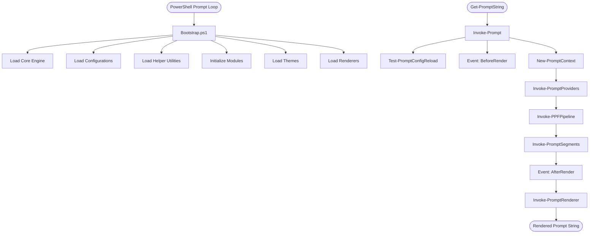
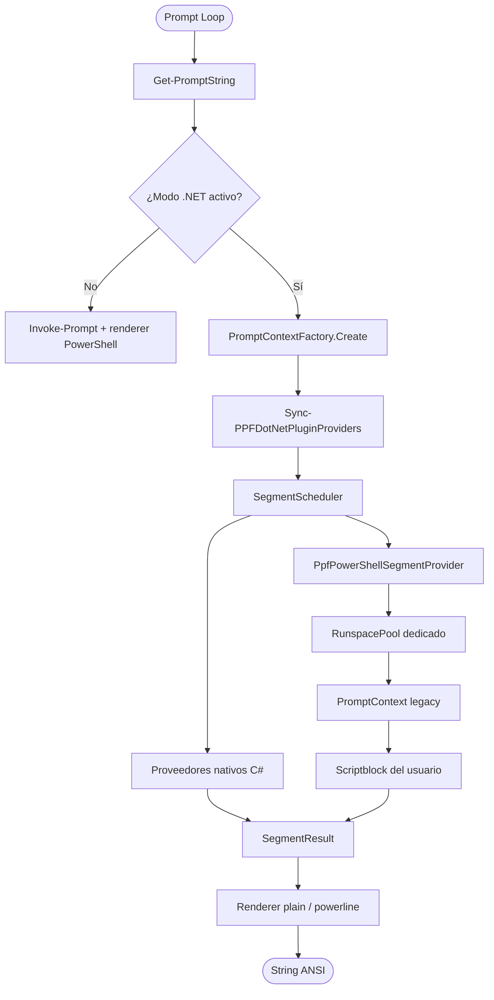

# Pablitus Prompt Framework v1.0 — Architecture Guide
> **Pablitus Prompt Framework v1.0 Architecture Frozen**

The Pablitus Prompt Framework (PPF) is designed around a single core philosophy: **Collect information once, render it anywhere.** 

To achieve this, the architecture completely decouples data gathering (Providers) from visual representation (Renderers). The two layers communicate exclusively through a shared context object (`PromptContext`).

---

## 1. High-Level Flow Diagram

The following diagram illustrates the lifecycle of a prompt execution, from PowerShell invocation to the rendered prompt string:



---

## 2. Bootstrapping & Load Order

When PPF is loaded (typically via `Bootstrap.ps1` in the user's profile), it loads the files in the following order:

1. **`Core/`**: Loads types, classes (`PromptContext`, `PromptSegment`), and core engines (Module Loader, Registry, Pipeline, Events, Cache, Rendering).
2. **`Configuration/`**: Defines default configurations (`Default.Configuration.ps1`) and Config Manager (`ConfigManager.ps1`) for imports, exports, and hot-reloading.
3. **`Utils/`**: Loads cross-cutting helper functions (e.g., `Command.Utils.ps1`).
4. **`Modules/`**: Discovers and imports modules. Each module is loaded in a specific order:
   - **Providers** (`*.Provider.ps1`): Registers context gathers.
   - **Services** (`*.Service.ps1`): Business logic and command wrappers.
   - **Segments** (`*.Segment.ps1`): Visual logic and segment registration.
5. **`Themes/`**: Loads every `*.Theme.ps1` file (`Default`, `Catppuccin`, `Dracula`, `Kali`, `Nord` by default). External themes are loaded on demand with `Import-PromptTheme`.
6. **`Renderers/`**: Loads available prompt renderers.

---

## 3. Lifecycle & Execution Pipeline

Every time PowerShell queries the prompt string (usually via the global `prompt` function), the following lifecycle occurs:

### Phase 1: Context Initialization
1. **Config Hot-Reload Check**: PPF checks if the configuration file has changed on disk. If so, it reloads it.
2. **BeforeRender Event**: Custom listeners registered to `BeforeRender` are executed.
3. **Context Instantiation**: A new instance of `PromptContext` is created.

### Phase 2: Pipeline Execution
1. **Providers Invocation**: Each registered provider runs in order of priority. Providers execute commands (e.g., `git status`, `kubectl config`) and populate their respective properties in the `PromptContext` (e.g., `$Context.Git`, `$Context.Docker`).
2. **Pipeline Middleware**: Post-processing steps (like profiling execution times) execute and add metadata to the context.

### Phase 3: Segment Registration
1. **Segments Resolution**: PPF evaluates registered segments. If a segment's visibility condition is met, a `PromptSegment` object is created and added to the `$Context.Segments` list.

### Phase 4: Rendering
1. **AfterRender Event**: Custom listeners registered to `AfterRender` are executed.
2. **Renderer Selection**: The active renderer (e.g., `PowerLine`, `ANSI`, `JSON`) receives the populated `PromptContext` and transforms it into the final string.

---

## 4. Key Architectural Rules

- **Zero Output during Gathering**: Providers must never output anything directly to the console or write color codes. They only save raw data to the context.
- **Renderers are Stateless**: Renderers must not call external executables or query environment states. They rely solely on the data inside the `PromptContext` and the active theme settings.
- **Priority-Driven**: Both Providers and Segments are ordered by a `Priority` integer. Lower numbers execute/render first.

---

## 5. Modo .NET opt-in y host de plugins

Desde la Fase 2 el módulo puede delegar el render en un núcleo .NET 8. La
integración es opt-in y conserva el motor PowerShell como fallback. Desde la
Fase 3A, los segmentos de usuario registrados con `Register-PromptSegment`
también se ejecutan en ese modo.

### 5.1 Flujo con el núcleo .NET



`Get-PromptString -Context <ctx>` sigue usando el pipeline PowerShell legacy. Sin
`-Context`, el adaptador usa el núcleo .NET cuando está activo. Si la DLL, el
tema o el render fallan, se registra el error y se continúa con `Invoke-Prompt`.

### 5.2 Scheduler y caché

El scheduler ejecuta los proveedores en paralelo, aplica timeout y cancelación
por segmento y conserva el orden de declaración. Un segmento que falla no
interrumpe a los demás. La caché es en memoria y su clave incluye el tipo, el
nombre, el estilo, los colores, el icono, los diamantes, la plantilla, las
propiedades del segmento, el directorio, la rama Git, el exit code, el usuario,
el host y el shell.

### 5.3 Plugins de usuario

El host no agrega `System.Management.Automation` al core. En su lugar,
`src/Core/PpfPowerShellPluginHost.cs` se compila con `Add-Type` la primera vez
que se necesita y se reutiliza durante la sesión. Cada proveedor tiene un
`RunspacePool` de un solo runspace que importa el módulo una vez.

Reglas del host:

- Los tipos nativos (`session`, `path`, `git`, `text`, `time`, `exit`) no pueden
  ser reemplazados por un plugin.
- Los cambios en `$script:PromptSegmentsVersion` disparan una resincronización;
  no se recorre el registro en cada prompt.
- El contexto .NET se traduce al `PromptContext` legacy, incluyendo sesión,
  path, git, timestamp, exit code, métricas y `$PWD`.
- Las propiedades del tema se convierten de `JsonElement` a hashtables, arrays
  y escalares, y se aplican con `Set-SegmentConfiguration`.
- El resultado del plugin se convierte a `SegmentResult`; una excepción se
  devuelve como `Failed` y no rompe el prompt.
- Los pools se liberan al desactivar el modo .NET o al descargar el módulo.

Ver `docs/adr/0003-powershell-plugin-host.md` para el contrato detallado, los
riesgos y las limitaciones de la Fase 3A.

### 5.4 Verificación en CI

CI compila y prueba el core en Linux y, en Windows, compila, prueba, publica la
DLL y ejecuta Pester antes del benchmark. La suite
`tests/DotNet.Parity.Tests.ps1` ejecuta el mismo plugin con el motor legacy y
con el host .NET y compara el texto del segmento. El script
`scripts/Measure-PPFDotNetCore.ps1` mide cold start, warm y overhead del host, y
falla si se exceden los presupuestos configurados. El JSON del benchmark se
publica como artefacto. Ver `docs/adr/0004-ci-parity-and-benchmarks.md`.

### 5.5 Prompt transitorio, tooltips y right prompt (Fase 3C)

Desde la Fase 3C el núcleo .NET renderiza tres funcionalidades de la línea de
comandos de Oh My Posh:

- **Right prompt**: un bloque `type: "rprompt"` (o `alignment: "right"`) se
  renderiza alineado a la derecha del prompt principal. Cuando se conoce el
  ancho de terminal (`TerminalWidth`), el núcleo combina ambos bloques con un
  `filler` repetido o un movimiento absoluto de cursor, y respeta `overflow:
  hide` (oculta el right prompt) o `overflow: break` (lo lleva a una nueva
  línea).
- **Prompt transitorio**: `template.transientPrompt` (o `transient_prompt` en
  temas OMP) define el prompt que se muestra tras aceptar un comando. Soporta
  `template`, `right_template`, `filler`, `newline`, `foreground` y
  `background`. Se expone con `Get-PromptString -Transient`.
- **Tooltips**: `tooltips` define segmentos right-aligned que se muestran al
  escribir palabras clave (`tips`). `tooltips_action` controla si reemplazan
  (`replace`, por defecto), extienden (`extend`) o anteponen (`prepend`) el
  right prompt actual. Se expone con `Get-PromptTooltip -Command <cmd>`.

El ancho de terminal, la línea de comandos y la columna del cursor se pasan
desde el llamador (CLI o adaptador PowerShell); el núcleo .NET no consulta la
consola, por lo que el resultado es determinista y testeable. Todo sigue bajo el
contrato opt-in (`PPF_USE_DOTNET_CORE=1`) con fallback al motor PowerShell.
Ver `docs/adr/0005-transient-tooltips-right-prompt.md`.

### 5.6 Multi-shell y packaging (Fase 3D)

Desde la Fase 3D PPF puede distribuirse como módulo de PowerShell y usarse desde
otros shells mediante scripts de inicialización.

#### Packaging (PowerShell Gallery)

El módulo se empaqueta como `.nupkg` para PowerShell Gallery usando el archivo
`PablitusPrompt.nuspec` en la raíz del repositorio. El script `build.ps1`
genera dos artefactos:

- `PablitusPrompt-v<version>.zip` — módulo para instalación manual.
- `PablitusPrompt.<version>.nupkg` — paquete para `Install-Module`.

Instalación desde PowerShell Gallery:

```powershell
Install-Module -Name PablitusPrompt -Scope CurrentUser
Import-Module PablitusPrompt -Force
```

#### Multi-shell

PPF es un módulo de PowerShell, pero incluye scripts de inicialización en
`src/ShellInit/` que permiten usarlo desde bash, zsh, fish y cmd invocando a
`pwsh` para obtener el prompt:

| Archivo | Shell | Uso |
|---------|-------|-----|
| `ppf.bash` | bash | `source /ruta/a/ppf.bash` en `~/.bashrc` |
| `ppf.zsh` | zsh | `source /ruta/a/ppf.zsh` en `~/.zshrc` |
| `ppf.fish` | fish | `source /ruta/a/ppf.fish` en `~/.config/fish/config.fish` |
| `ppf.cmd` | cmd | Llamar desde un macro o AutoRun |

Estos scripts inician `pwsh` para renderizar el prompt de PPF y lo inyectan como
`PS1`/`PROMPT` del shell anfitrión. Nota: iniciar `pwsh` en cada prompt añade
un coste de arranque; para uso diario se recomienda usar PPF directamente desde
PowerShell 7+.

El núcleo .NET no consulta la consola; el ancho de terminal, la línea de
comandos y la columna del cursor se pasan desde el llamador, por lo que el
resultado es determinista y testeable. Todo sigue bajo el contrato opt-in
(`PPF_USE_DOTNET_CORE=1`) con fallback al motor PowerShell.
